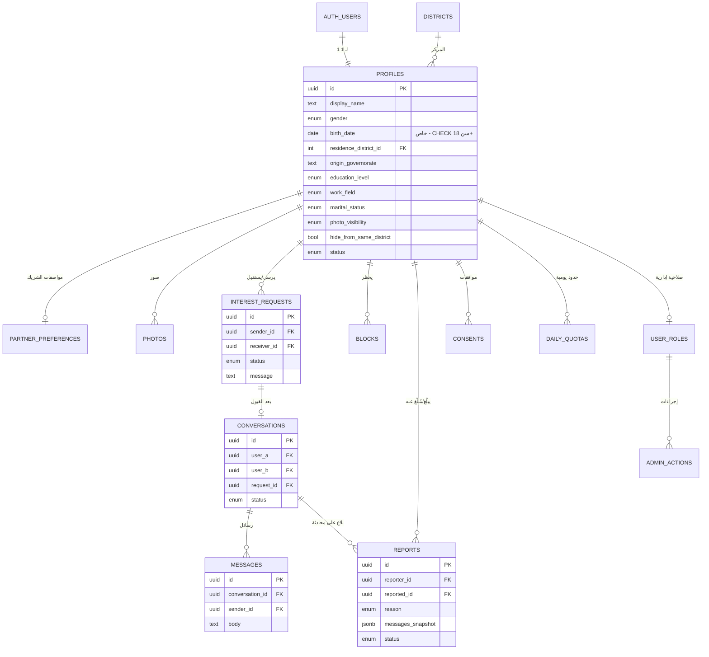

# جواز دمياط: تقرير المرحلة الأولى المحدّث (v1.1)

**التاريخ:** 27 نوفمبر 2026
**الحالة:** تخطيط فقط. **مفيش قاعدة بيانات حقيقية اتعملت، ومفيش أي بيانات مستخدمين اتجمعت، ومفيش كود SQL ولا اختبارات اتكتبت.** المرحلة التانية مستنية موافقتك على التقرير ده.
**يكمّل:** `PROJECT_PLAN.md`. أي حاجة هنا بتعارض الخطة الأصلية، المكتوب هنا هو الأحدث.

> **تنبيه قانوني:** كل المعلومات القانونية هنا من **مصادر ثانوية** (مكاتب محاماة، مواقع متخصصة، صحف). حاولت أفتح نصوص اللائحة المنشورة على مواقع قانونية، لكن الوصول ليها **اتمنع من بيئة العمل** (الشبكة مقفولة على المواقع دي). يعني **مفيش ولا معلومة قانونية هنا متأكد منها من النص الرسمي.** المرجع النهائي: القانون 151 لسنة 2020 واللائحة في الوقائع المصرية، وقرارات مركز حماية البيانات الشخصية، ورأي محامٍ.

---

## 1. القرارات الـ 12 كاملة (القسم 11 من الخطة) + 3 قرارات جديدة

| # | القرار | الخيارات | توصيتي | اتغيرت؟ |
|---|---|---|---|---|
| 1 | **مكان المشروع** | ريبو جديد / جوه ريبو «كشف» | ريبو جديد **خاص** (`damietta-match`). أنا ما أقدرش أنشئه: إنت تنشئه وتضيفه للجلسة | لا |
| 2 | **التقنيات** | React + Vite + TypeScript (PWA)، وقاعدة بيانات PostgreSQL بصلاحيات RLS | موافقة على الواجهة وPostgres. **مكان الاستضافة اتأجل للقرار 13** | **نعم** |
| 3 | **التحقق من الحساب** | بريد / تليفون (SMS مدفوع) / الاتنين | بريد بس في البداية، والتليفون مؤجل | لا |
| 4 | **حقل الدين** | نسجّله (بيانات حساسة) / ما نسجّلوش / شرط عام في الشروط | **ما نسجّلوش** لحد رأي المحامي. تسجيله معناه بيانات حساسة، يعني ترخيص وموافقة كتابية صريحة | لا |
| 5 | **الأهلية** | مقيم في دمياط / أصله منها / الاتنين | الاتنين (أصل **أو** إقامة) | لا |
| 6 | **سياسة الصورة** | مخفية حتى القبول / ظاهرة للمرشحين / اختيار المستخدم | مخفية افتراضيًا، والمستخدم يقدر يغيّرها | لا |
| 7 | **الحدود اليومية** | — | 10 ترشيحات، و20 نتيجة بحث، و5 طلبات تعارف (تتعدل بعد التجربة) | لا |
| 8 | **وصول المشرف للمحادثات** | كلها / المبلّغ عنها بس / ولا حاجة | المبلّغ عنها بس، ومتطبّق في قاعدة البيانات | لا |
| 9 | **شكل الإطلاق الأول** | عام / مغلق بالدعوة | مغلق، **وعلى مرحلتين: الأولى من غير أي بيانات حقيقية (القسم 4)**، والتانية بمستخدمين حقيقيين بعد الموقف القانوني | **نعم** |
| 10 | **الاستشارة القانونية** | — | **إجبارية قبل أي بيانات حقيقية**، مش قبل الإطلاق العام بس | **نعم** |
| 11 | **اسم التطبيق** | «جواز دمياط» / بديل | يتأكد إنه مش علامة تجارية مسجلة. ممكن بديل أرسمى | لا |
| 12 | **المشرفين** | — | إنت + مشرفة واحدة على الأقل | لا |
| 13 | **مكان تخزين البيانات** (جديد) | (أ) Supabase المستضاف في أوروبا + ترخيص نقل / (ب) Supabase مستضاف ذاتيًا على سيرفر في مصر / (ج) Postgres + خادم صغير على سيرفر في مصر | **التطوير محليًا دلوقتي، والقرار بعد رأي المحامي** (القسم 3) | جديد |
| 14 | **الشكل القانوني** (جديد) | فرد / شركة | يتحدد مع المحامي، لأنه بيأثر على الترخيص والرسوم والمسؤولية | جديد |
| 15 | **مسؤول حماية البيانات** (جديد) | — | لازم حد يتحدد ويتسجل حسب المصادر. يتحدد مع المحامي | جديد |

---

## 2. المتطلبات القانونية قبل جمع بيانات مستخدمين حقيقيين

### 2.1 ليه القانون بينطبق حتى على تجربة صغيرة؟
اسم المستخدم الأول وسنه ومركزه وبريده **بيانات شخصية** بالتعريف، حتى لو المستخدمين 20 بس. **ما لقيتش في المصادر أي استثناء بعدد المستخدمين.** الإعفاء اللي ظهر (القسم 2.3) **من الرسوم بس، مش من الترخيص**. فالأمان إننا نعتبر إن **أي تجربة فيها أشخاص حقيقيين محتاجة توفيق أوضاع**.

### 2.2 قائمة المتطلبات (كل بند محتاج تأكيد من المحامي)
| # | المتطلب | ما ذكرته المصادر | درجة التأكد |
|---|---|---|---|
| 1 | **ترخيص أو تصريح كمتحكم في البيانات** من مركز حماية البيانات الشخصية | اللائحة بتلزم الجهة اللي بتجمع بيانات شخصية بالحصول على ترخيص أو تصريح كمتحكم أو معالج، ومدة الترخيص 3 سنين، والطلب من خلال بوابة إلكترونية | متوسطة (أكتر من مصدر متفق) |
| 2 | **ترخيص نقل البيانات عبر الحدود** لو السيرفر بره مصر | المادة 14 من القانون: ممنوع النقل لدولة أجنبية إلا بمستوى حماية لا يقل عن القانون المصري **وبترخيص أو تصريح من المركز**. ومصادر بتقول إن اللائحة بتعتبر **التخزين بره مصر = نقل** | متوسطة في وجوب الترخيص، **ضعيفة** في حكاية «التخزين = نقل» (مصدر تحليلي واحد) |
| 3 | **موافقة المستخدم على النقل للخارج** | المصادر **مختلفة**: بعضها بيقول الموافقة مطلوبة في كل نقل بالإضافة للترخيص، وبعضها بيقول إنها استثناء من استثناءات المادة 15 | **غير محسوم**، ولازم النص الرسمي |
| 4 | **البيانات الحساسة** (الدين، الصحة، البيانات البيومترية، المالية، الآراء السياسية، الحالة الأمنية، وكل بيانات الأطفال) | محتاجة **موافقة صريحة ومكتوبة** وترخيص | متوسطة إلى عالية |
| 5 | **مسؤول حماية البيانات** | المتحكم ملزم بتحديد مسؤول حماية بيانات، واللائحة بتنظم قيده | متوسطة |
| 6 | **إبلاغ المركز عن أي اختراق** | خلال 72 ساعة | متوسطة |
| 7 | **عقد معالجة** مع كل خدمة بتلمس البيانات (Supabase، مزود البريد، الاستضافة) | Supabase عنده اتفاقية معالجة بيانات (DPA) منشورة | عالية بالنسبة لوجود الاتفاقية. مدى كفايتها للقانون المصري **غير معروف** |
| 8 | **سياسة خصوصية، وسجل موافقات، وحقوق المستخدم** (الاطلاع والتصحيح والحذف)، **ومدة احتفاظ** واضحة | جزء أساسي من القانون | عالية في المبدأ، والتفاصيل مع المحامي |

### 2.3 الرسوم والعقوبات (حسب المصادر، غير مؤكد)
- **السقف في القانون:** رسوم الترخيص ما تتعداش مليوني جنيه، والتصريح ما يتعداش 500 ألف جنيه (اليوم السابع).
- **جدول رسوم المتحكم والمعالج للأشخاص الاعتبارية** (موقع مسار): **من 1 لحد 100 ألف سجل معفي من رسوم الترخيص**. بعد كده الرسوم بتتدرج (مثلًا 200 جنيه لشريحة 101 إلى 200 ألف). ومصدر تاني بيقول إن **الإعفاء من الرسوم بس، والتسجيل لسه مطلوب**.
- **ترخيص النقل عبر الحدود:** 50% من رسوم ترخيص المتحكم. لو الرسوم الأصلية صفر، النقل غالبًا صفر كمان، **لكن ده استنتاج مني ومحتاج تأكيد**.
- **الأشخاص الطبيعيين:** المصادر بتقول إن ليهم شروط مختلفة، **لكن ما لقيتش جدول الرسوم الخاص بيهم**.
- **العقوبة:** خبر في اليوم السابع (13 نوفمبر 2026) بيقول إن نقل بيانات المصريين للخارج من غير الضوابط عقوبته **حبس 3 شهور وغرامة لحد 5 ملايين جنيه**. محتاج تأكيد من نص القانون.
- **المواعيد:** اللائحة اتنشرت في الوقائع المصرية في 1 نوفمبر 2025 تقريبًا، ومهلة التوفيق سنة. **غالبًا المهلة خلصت.**

### 2.4 أسئلة محددة للمحامي (محدّثة)
1. هل صاحب المشروع كفرد يقدر يحصل على ترخيص أو تصريح متحكم، ولا لازم شركة؟ وإيه الفرق في الرسوم والمسؤولية؟
2. مشروع أقل من 100 ألف سجل: معفي من **الرسوم** بس، ولا من **الترخيص** كمان؟
3. هل **تخزين** البيانات على سيرفر في ألمانيا مثلًا يُعتبر «نقل عبر الحدود» محتاج ترخيص؟
4. هل **مرور** البيانات عبر شبكة توزيع زي Cloudflare من غير تخزين يُعتبر نقل؟
5. موافقة المستخدم على النقل للخارج: شرط **إضافي** للترخيص، ولا **بديل** عنه؟
6. هل المركز أصدر قائمة دول معتمدة بمستوى حماية كافي؟ وهل الاتحاد الأوروبي منها؟
7. هل **الصورة الشخصية العادية** (من غير تعرّف على الوجه) بيانات بيومترية؟
8. **الدين** في تطبيق زواج: الأفضل ما نسجّلوش، ولا نسجّله بترخيص؟
9. مين ينفع يكون **مسؤول حماية البيانات**؟ صاحب المشروع نفسه ينفع؟
10. مدة الاحتفاظ بالبلاغات بعد حذف حساب المبلّغ عنه.
11. التزاماتنا لو جهة تحقيق طلبت بيانات في قضية ابتزاز أو نصب.
12. هل فيه اشتراطات إضافية على تطبيقات التعارف والزواج من أي جهة تانية؟
13. هل **تجربة بيانات وهمية بالكامل** (القسم 4) محتاجة أي ترخيص؟ (توقعي لا، لكن يتأكد.)
14. العلامة التجارية لاسم التطبيق.

---

## 3. مراجعة Supabase من ناحية مكان التخزين

### 3.1 الحقائق
- Supabase المستضاف بيحط كل مشروع في **منطقة واحدة**: قاعدة البيانات والحسابات والملفات كلهم في نفس المنطقة.
- صفحة المناطق الرسمية فيها **17 منطقة** في الأمريكتين وأوروبا وآسيا والمحيط الهادي. **مفيش منطقة في مصر ولا في الشرق الأوسط** حسب البحث (ما قدرتش أفتح الصفحة الحية نفسها، فده يتأكد).
- أقرب منطقة عمليًا لمصر: **فرانكفورت** (ألمانيا).
- Supabase بيستخدم خدمات فرعية زي AWS وGoogle وFly.io، وتقييم نقل البيانات المنشور عندهم بيذكر إن بعضهم خاضع لقانون المراقبة الأمريكي (FISA 702).
- **Supabase مفتوح المصدر** ويقدر يتشغّل على سيرفر خاص. ساعتها اتفاقية Supabase والتزاماتها ما بتنطبقش، ومكان البيانات يبقى السيرفر بتاعنا.

### 3.2 النتيجة
**Supabase المستضاف = البيانات مخزنة بره مصر.** وده معناه في الغالب: ترخيص نقل عبر الحدود، وإثبات مستوى حماية كافي في الدولة المستقبلة، وغالبًا موافقة المستخدم. **ده ممكن قانونيًا لو المحامي أكد إن الترخيص متاح، لكنه مش مضمون.**

### 3.3 البدائل
| الخيار | الوصف | المميزات | العيوب | التكلفة |
|---|---|---|---|---|
| **(أ) Supabase المستضاف (فرانكفورت) + ترخيص نقل** | زي الخطة الأصلية | أسهل وأأمن تقنيًا لفرد، وفيه نسخ احتياطي وتحديثات أمنية وMFA جاهزين | محتاج ترخيص نقل وموافقة، ومخاطر العقوبة لو الترخيص ما اتعملش | مجاني في التجربة، وحوالي 25 دولار شهريًا في الإنتاج (يتأكد) |
| **(ب) Supabase مستضاف ذاتيًا على سيرفر في مصر** | نفس الكود بالظبط على سيرفر في مركز بيانات مصري (مثلًا: Orange Business، مركز Cloud4C مع المصرية للاتصالات، EgyptNetwork في المنصورة) | البيانات في مصر، ونفس التصميم ونفس سياسات RLS | **إنت المسؤول عن** التحديثات الأمنية والنسخ الاحتياطي والمراقبة. أي إهمال في الصيانة = ثغرة. ومحتاج تتأكد إن السيرفر فعلًا في مصر | سيرفر في مصر: **ما لقيتش أسعار منشورة، محتاج عروض أسعار**، والتكلفة الأكبر وقت الصيانة |
| **(ج) Postgres + خادم صغير (Node) على سيرفر في مصر** | من غير Supabase | أخف وأبسط في التشغيل | كود أكتر للحسابات والملفات والمحادثة اللحظية، وده معناه احتمال أخطاء أمنية أكبر | زي (ب) + وقت تطوير أكتر |

### 3.4 التوصية
1. **دلوقتي:** نطوّر ونختبر **محليًا بالكامل** بـ Supabase CLI (بيشتغل على Docker في الجهاز، من غير أي حساب أو سيرفر خارجي) **وببيانات وهمية بس**.
2. **نكتب التصميم بحيث يبقى قابل للنقل:** كل حاجة SQL قياسي على Postgres (الجداول، وRLS، والدوال)، ونقلل الاعتماد على مميزات خاصة بـ Supabase المستضاف. كده التحويل بين (أ) و(ب) بعدين **مش هيحتاج إعادة كتابة**.
3. **بعد رأي المحامي:**
   - لو ترخيص النقل متاح ومعقول: **(أ)**، لأنه الأأمن تشغيليًا لفرد.
   - لو التخزين لازم يكون في مصر: **(ب)**، مع عقد صيانة أو حد متخصص.
   - (ج) بس لو (ب) طلع غير عملي.
4. **ملحوظة:** البريد الإلكتروني نفسه بيعدّي على سيرفرات بره مصر (مزود الإرسال، و Gmail عند المستخدم). ده لازم يتسأل فيه المحامي كمان.

---

## 4. هل ينفع تجربة مغلقة من غير بيانات شخصية حقيقية؟

### 4.1 الإجابة: نعم، بشكل محدود
ينفع نعمل **«تجربة داخلية» (المرحلة صفر)** فيها:
- **كل الملفات وهمية:** أسماء وأعمار ومراكز متولدة عشوائيًا (مثلًا 300 ملف وهمي)، وصور رمزية (أحرف أو رسومات)، **مش صور أشخاص حقيقيين ولا صور متولدة بالذكاء الاصطناعي لوجوه**.
- **الحسابات تجريبية جاهزة:** المختبرين (إنت والفريق) يدخلوا بحسابات معمولة مسبقًا ببريد وهمي (`tester01@example.test`). البريد بيتجمّع في صندوق تجريبي محلي (Mailpit/Inbucket)، ومفيش بريد حقيقي بيتبعت.
- **التسجيل مقفول:** مفيش زر «إنشاء حساب» مفتوح للعامة. شريط ثابت فوق: «نسخة تجريبية: لا تدخل أي بيانات حقيقية».
- **مكان التشغيل:** على جهازك أو جهاز تجريبي، أو على رابط مؤقت **محمي بكلمة سر** ومن غير أي أدوات إحصائيات أو تتبع.
- **اختبار مع أشخاص من بره الفريق** ممكن **وجهًا لوجه على جهاز تجريبي** فيه البيانات الوهمية، من غير ما يعملوا حسابات، ومن غير تسجيل صوت أو صورة. كده مفيش بيانات بتتجمع.

> حتى في التجربة الداخلية: لو الموقع على الإنترنت، السيرفر بيسجّل عناوين IP للزوار، وده ممكن يُعتبر بيانات شخصية. عشان كده التوصية: التشغيل المحلي أولًا، أو رابط محمي للفريق بس. **(سؤال 13 للمحامي.)**

### 4.2 اللي ينفع يتختبر بأمان
| المجال | ينفع؟ |
|---|---|
| خطوات التسجيل وإكمال الملف وسهولتها (بحسابات تجريبية) | ✅ |
| شكل الواجهات، وRTL، والوضوح لغير المتخصصين، والأداء على موبايل ضعيف | ✅ |
| خوارزمية التوافق والترشيحات (منطقها وصحتها) | ✅ |
| الحدود اليومية (ترشيحات، بحث، طلبات) | ✅ |
| طلبات التعارف: إرسال وقبول ورفض وانتهاء | ✅ |
| المحادثة اللحظية، وإنهاء المحادثة | ✅ |
| الحظر والإبلاغ، ومسار البلاغ في لوحة الإدارة | ✅ |
| لوحة الإدارة: الإيقاف، ومراجعة الملفات، والإحصائيات، وسجل الإجراءات | ✅ |
| حذف الحساب والتأكد إن كل البيانات اتمسحت فعلًا | ✅ |
| **اختبارات الصلاحيات (RLS):** محاولة مستخدم يقرا بيانات غيره أو رسائل مش بتاعته أو صورة من غير إذن | ✅ (أهم حاجة) |
| اختبار ضغط بسيط (مئات المستخدمين الوهميين) | ✅ |

### 4.3 اللي ما ينفعش يتختبر من غير مستخدمين حقيقيين
- جودة الترشيح الفعلية (هل الناس هتقبل بعض؟).
- الطلب الحقيقي ونسبة الرجال للسيدات.
- سلوك المسيئين والنصّابين الحقيقي، وحجم شغل الإشراف.
- وصول البريد لصناديق المستخدمين الحقيقيين (Spam).

---

## 5. تصميم قاعدة البيانات المبدئي (ERD)

> ده **رسم للمراجعة بس**. مفيش SQL اتكتب. التفاصيل والسياسات بالكود والاختبارات بعد موافقتك على المرحلة التانية.

**أهم قواعد الصلاحيات المخططة** (موجودة بالتفصيل في `PROJECT_PLAN.md` القسم 7.2): مفيش مستخدم يقرا جدول `profiles` لغيره مباشرة، والعرض من خلال دالة بأعمدة محدودة. الرسائل لطرفي المحادثة بس، والمشرف ما يشوفهاش. الصور من خلال روابط مؤقتة بشرط الصلاحية. والحظر بيقفل كل حاجة بين الطرفين.

**خطة الاختبار (لما توافق):** Supabase محلي على Docker، وبيانات وهمية متولدة بسكريبت، واختبارات pgTAP بتحاول تكسر كل سياسة (مثلًا «المستخدم أ يحاول يقرا رسائل محادثة بين ب و ج» لازم تفشل). **مفيش أي اتصال بسيرفر خارجي.**

---

## 6. التكلفة المحدّثة

| المرحلة | البند | التكلفة |
|---|---|---|
| **المرحلة صفر** (تطوير وتجربة داخلية ببيانات وهمية) | كل حاجة محلية + GitHub | **0** |
| **قبل البيانات الحقيقية** | استشارة محامٍ متخصص | **غير معروفة، والبند ده الأهم** |
| | رسوم ترخيص المتحكم | ممكن تكون **معفية تحت 100 ألف سجل** للأشخاص الاعتبارية حسب مصدر ثانوي. للأفراد: غير معروف |
| | رسوم ترخيص النقل (لو الخيار أ) | 50% من رسوم المتحكم حسب المصادر |
| | نطاق (Domain) | حوالي 10 إلى 15 دولار سنويًا (اختياري) |
| **تجربة حقيقية مغلقة** | الخيار (أ) Supabase المستضاف | مجاني لحد حدود الخطة. **بوصي بالخطة المدفوعة (حوالي 25 دولار شهريًا، يتأكد) من أول يوم فيه بيانات حقيقية**، عشان النسخ الاحتياطي اليومي، ولأن المجاني بيوقف المشروع بعد 7 أيام بدون نشاط |
| | الخيار (ب) سيرفر في مصر | **محتاج عروض أسعار**، + تكلفة صيانة (وقت أو شخص) |
| | البريد | مجاني لحد 100 رسالة يوميًا (Resend)، وبعد كده حوالي 20 دولار شهريًا |
| **مؤجل** | SMS | من 0.11 لحد 0.40 دولار للرسالة، ومش هيتفعل من غير موافقتك |

---

## 7. المخاطر المحدّثة

### قانونية
| الخطر | الأثر | المعالجة |
|---|---|---|
| جمع بيانات حقيقية من غير ترخيص | **حرج** (عقوبات تصل لحبس وغرامة ملايين حسب المصادر) | **مفيش بيانات حقيقية قبل رأي المحامي والترخيص.** المرحلة صفر بيانات وهمية بس |
| تخزين بالخارج من غير ترخيص نقل | **حرج** | قرار 13 بعد المحامي، والتصميم قابل للنقل |
| معلومات قانونية غلط في التقرير ده | عالي | كل البنود معلّمة بدرجة تأكدها، ومفيش قرار نهائي من غير محامٍ |
| البيانات الحساسة (الدين) | عالي | مش هتتسجل في الوقت الحالي |
| مستخدم قاصر | عالي | إقرار بالسن + بلاغ + إيقاف فوري. **مفيش حل كامل من غير تحقق هوية** |

### تقنية
| الخطر | الأثر | المعالجة |
|---|---|---|
| ثغرة صلاحيات | **حرج** | اختبارات RLS آلية في CI قبل أي نشر |
| الاستضافة الذاتية (لو اخترنا ب) من غير صيانة كويسة | **عالي** | عقد صيانة، وتحديثات تلقائية، ونسخ احتياطي مشفّر مختبر |
| الارتباط بخدمة واحدة | متوسط | SQL قياسي، ومميزات Supabase الخاصة في أضيق نطاق |
| تسريب بيانات وهمية تتفهم إنها حقيقية | منخفض | أسماء وهمية واضحة، وشريط «نسخة تجريبية» |

---

## 8. المطلوب منك للموافقة
1. موافقة أو تعديل على القرارات الـ 15 (القسم 1).
2. موافقة على إن المرحلة التانية تبقى: **تصميم قاعدة البيانات + سياسات RLS + اختبارها محليًا ببيانات وهمية بس**، من غير أي سيرفر أو حساب خارجي.
3. إنشاء الريبو الجديد الخاص وإضافته للجلسة، أو موافقة إننا نكمّل مؤقتًا في المجلد ده.
4. البدء في التواصل مع محامٍ بالأسئلة في القسم 2.4، بالتوازي مع التطوير.

---

## 9. المصادر
**رسمية أو من مقدّم الخدمة:**
- [Supabase Available Regions](https://supabase.com/regions) و [Regions docs](https://supabase.com/docs/guides/platform/regions)
- [Supabase Data Residency and Transfers FAQ](https://supabase.com/legal/privacy-resources/data-residency-and-transfers-faq)
- [Supabase Data Processing Addendum](https://supabase.com/legal/customer-resources/data-processing-addendum)
- [Supabase TIA](https://supabase.com/downloads/docs/Supabase+TIA+241009.pdf)

**نصوص قانونية منشورة من غير الجهة الرسمية (ما اتفتحتش من بيئة العمل):**
- [اللائحة التنفيذية – مسار](https://masaar.net/ar/legal_documents/%D8%A7%D9%84%D9%84%D8%A7%D8%A6%D8%AD%D8%A9-%D8%A7%D9%84%D8%AA%D9%86%D9%81%D9%8A%D8%B0%D9%8A%D8%A9-%D9%84%D9%82%D8%A7%D9%86%D9%88%D9%86-%D8%AD%D9%85%D8%A7%D9%8A%D8%A9-%D8%A7%D9%84%D8%A8%D9%8A/)
- [مادة 19 من اللائحة – مسار](https://masaar.net/ar/egypt_laws/17487/)
- [القرار 816 لسنة 2025 – الحسوة](https://alhasswalawfirm.com/law-library/decree-816-2025)
- [Law No. 151 of 2020 – Andersen](https://eg.andersen.com/wp-content/uploads/2026/02/Law-No.-151-of-2020.pdf)
- [Executive Regulations – Sedona Conference](https://www.thesedonaconference.org/sites/default/files/meeting_paper/7.4%20Egypt%20Personal%20Data%20Protection%20Law%20-%20Executive%20Regulations.pdf)

**تحليلات وأخبار:**
- [اليوم السابع: تفاصيل التراخيص والتصاريح](https://www.youm7.com/story/2026/5/24/%D8%AA%D9%81%D8%A7%D8%B5%D9%8A%D9%84-%D8%A7%D9%84%D8%AA%D8%B1%D8%A7%D8%AE%D9%8A%D8%B5-%D9%88%D8%A7%D9%84%D8%AA%D8%B5%D8%A7%D8%B1%D9%8A%D8%AD-%D8%A7%D9%84%D8%B5%D8%A7%D8%AF%D8%B1%D8%A9-%D8%B9%D9%86-%D9%85%D8%B1%D9%83%D8%B2-%D8%AD%D9%85%D8%A7%D9%8A%D8%A9-%D8%A7%D9%84%D8%A8%D9%8A%D8%A7%D9%86%D8%A7%D8%AA-%D8%A7%D9%84%D8%B4%D8%AE%D8%B5%D9%8A%D8%A9-%D8%A8%D8%A7%D9%84%D9%82%D8%A7%D9%86%D9%88%D9%86/7425868)
- [اليوم السابع: عقوبة نقل البيانات للخارج](https://www.youm7.com/story/2026/11/13/%D8%A7%D9%84%D8%AD%D8%A8%D8%B3-3-%D8%A3%D8%B4%D9%87%D8%B1-%D9%88%D8%BA%D8%B1%D8%A7%D9%85%D8%A9-5-%D9%85%D9%84%D8%A7%D9%8A%D9%8A%D9%86-%D8%AC%D9%86%D9%8A%D9%87-%D8%A7%D9%84%D9%82%D8%A7%D9%86%D9%88%D9%86-%D9%8A%D8%B9%D8%A7%D9%82%D8%A8-%D9%86%D9%82%D9%84/7614286)
- [شورى للمحاماة: اللائحة التنفيذية](https://shuralawfirm.com/%d8%a7%d9%84%d9%84%d8%a7%d8%a6%d8%ad%d8%a9-%d8%a7%d9%84%d8%aa%d9%86%d9%81%d9%8a%d8%b0%d9%8a%d8%a9-%d9%84%d9%82%d8%a7%d9%86%d9%88%d9%86-%d8%ad%d9%85%d8%a7%d9%8a%d8%a9-%d8%a7%d9%84%d8%a8%d9%8a%d8%a7/)
- [القاضي للمحاماة](https://elkadylegal.com/law-data-protection-exec/)
- [Chambers: First look at the Executive Regulations](https://chambers.com/articles/a-first-look-at-egypt-s-personal-data-protection-executive-regulations)
- [Legal 500: Cross-border transfers](https://www.legal500.com/guides/hot-topic/strategic-challenges-and-opportunities-in-cross-border-data-transfers-under-egypts-personal-data-protection-regime/)
- [Raqmix: Storage abroad is a transfer](https://raqmix.net/insights/pdpl-executive-regulations-egypt)
- [Consortio: Cross-border transfer rules](https://consortiolawfirm.com/cross-border-data-transfer-egypt-pdpl/)
- [Kennedys](https://www.kennedyslaw.com/en/thought-leadership/article/2026/egypt-s-personal-data-protection-law-the-compliance-countdown-has-begun/)
- [Clyde & Co](https://www.clydeco.com/en/insights/2026/01/egypt-regulatory-update-on-data-privacy)
- [CMS](https://cms.law/en/are/legal-updates/egypt-s-pdpl-executive-regulations-issued-one-year-compliance-countdown-begins)
- [RecordingLaw](https://www.recordinglaw.com/ar/world-laws/world-data-privacy-laws/egypt-data-privacy-laws/)
- [DLA Piper](https://www.dlapiperdataprotection.com/guide.pdf?c=EG)

**مراكز بيانات في مصر (صفحات تجارية، غير متحقق منها):**
- [Orange Business Egypt](https://datacenters.com/orange-business-egypt)
- [Cloud4C + Telecom Egypt](https://telecomtalk.info/cloud4c-cloud-data-center-with-telecom-egypt/636135/)
- [EgyptNetwork Mansoura](https://www.datacentermap.com/egypt/mansura/egyptnetwork/)
- [Trade.gov: Egypt Data Centers](https://www.trade.gov/market-intelligence/egypt-data-centers)
